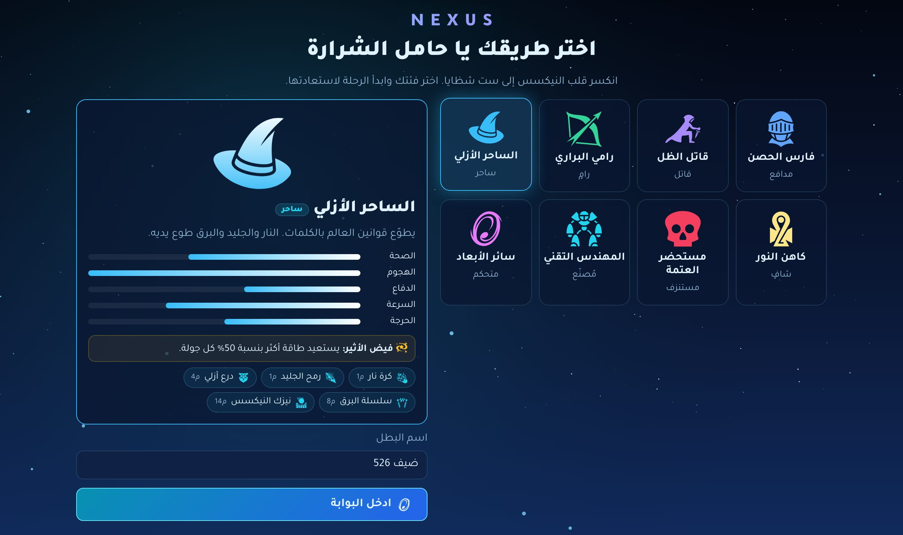
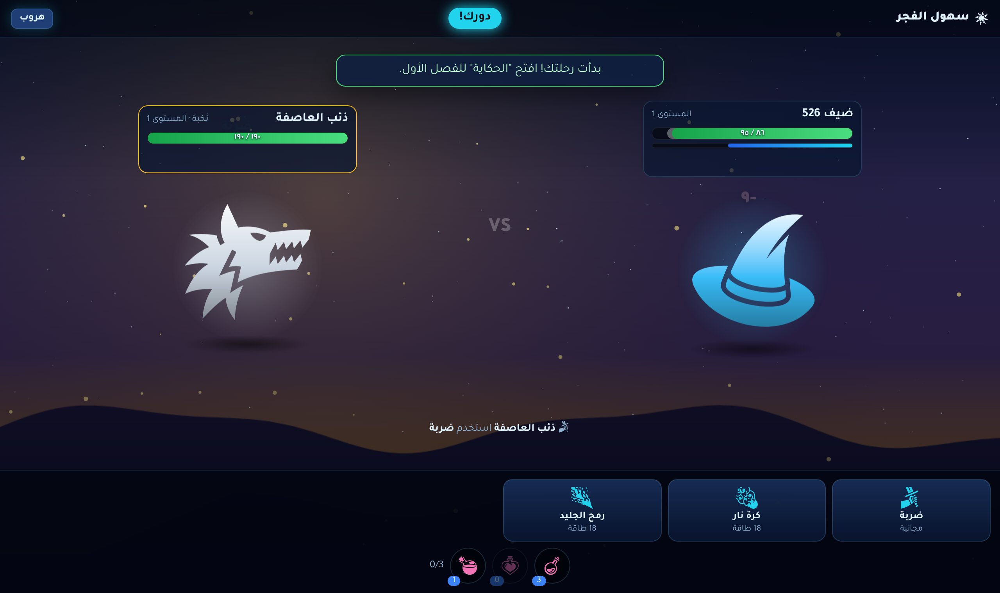
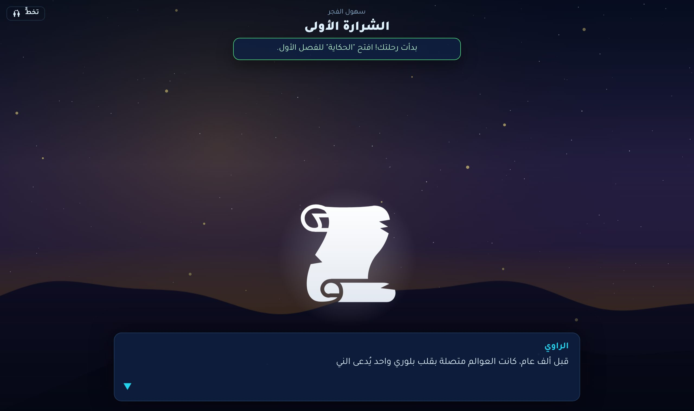
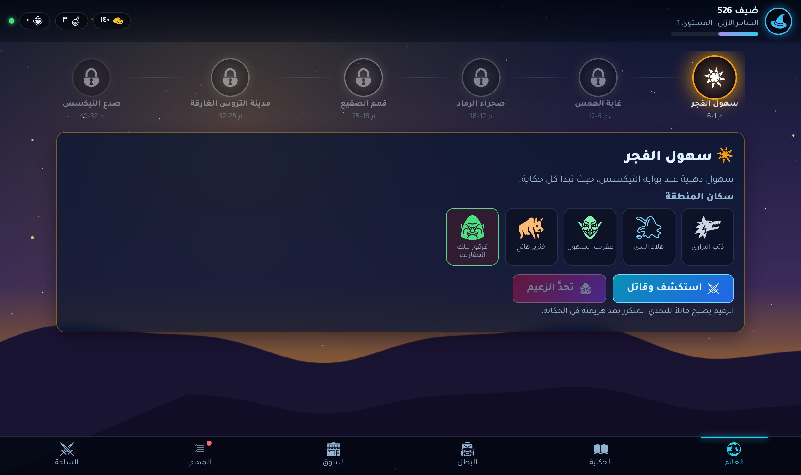

# NEXUS — لعبة Discord Activity

لعبة تقمّص أدوار كاملة تعمل **داخل Discord** كنشاط (Activity): تُفتح من زر الأنشطة 🚀 في القناة الصوتية أو النصية، ويلعبها كل من في القناة معاً.

| | |
|---|---|
|  |  |
|  |  |

> هذا إصدار مبني من الصفر (v4). النسخة القديمة (البوت ذو الأوامر والصور) ما زالت في فرع `main`.

## ما في اللعبة

| | |
|---|---|
| **8 فئات** | فارس الحصن، قاتل الظل، رامي البراري، الساحر الأزلي، كاهن النور، مستحضر العتمة، المهندس التقني، سائر الأبعاد. لكل فئة 5 مهارات تُفتح مع المستوى، وقدرة خاصة دائمة. |
| **الحكاية** | 18 فصلاً بحوارات مصوّرة: اجمع شظايا قلب النيكسس الست واهزم مالفار سيد الفراغ. |
| **6 مناطق** | سهول الفجر، غابة الهمس، صحراء الرماد، قمم الصقيع، مدينة التروس الغارقة، صدع النيكسس. لكل منطقة خلفية مرسومة بالكود وجزيئات خاصة بها (ثلج، جمر، يراعات...). |
| **24 وحشاً + 6 زعماء** | الزعماء يدخلون حالة «هيجان» عند نصف الصحة، ويمكن تحديهم مجدداً بعد هزيمتهم في الحكاية. |
| **قتال بالأدوار** | حرق، سم، نزيف، صعق، تجمّد، إسكات، دروع، تجدد، توابع... يُحسب كله على الخادم (لا غش). |
| **مبارزات حية** | تحدَّ أي لاعب موجود معك في نفس النشاط. 30 ثانية لكل دور. |
| **أدوات** | سلاح، درع، تميمة بست ندرات: شائع، نادر، ملحمي، أسطوري، خرافي، **سرّي**. |
| **السوق** | جرعات شفاء وطاقة، وصندوق المغامر. |
| **مهام يومية** | 3 مهام تتغير يومياً + صندوق كبير + مكافأة دخول متصاعدة. |
| **المتصدرون** | حسب المستوى وحسب تصنيف المبارزات. |

### قواعد الخسارة (كما قررتها)
- **مبارزة ضد لاعب:** الخاسر يفقد **30%** من خبرة مستواه الحالي، وقد تسقط **أداة واحدة من حقيبته** للفائز. فرصة السقوط حسب الندرة: شائع 25%، نادر 15%، ملحمي 8%، أسطوري 3%، خرافي 1%، سرّي 0.01%. العتاد المجهّز لا يسقط أبداً.
- **ضد الوحوش والزعماء:** تفقد **10%** من خبرة مستواك، ولا تسقط أي أداة.
- لا ينزل مستواك أبداً بسبب الخسارة.

---

## التشغيل خطوة بخطوة

### 1) إعداد التطبيق في Discord
1. افتح <https://discord.com/developers/applications> واختر تطبيقك (أو أنشئ جديداً).
2. **General Information**: انسخ `APPLICATION ID` (هو `DISCORD_CLIENT_ID`).
3. **OAuth2**: انسخ `Client Secret` (هو `DISCORD_CLIENT_SECRET`)، وأضف في **Redirects** الرابط `https://127.0.0.1` (مطلوب شكلياً).
4. **Activities → Settings**: فعّل **Enable Activities**، واختر المنصات (Web, iOS, Android).
5. **Activities → URL Mappings**: في خانة `/` (Root Mapping) ضع عنوان استضافتك **بدون** `https://`، مثل: `nexus-game.onrender.com`.
6. **Installation**: ثبّت التطبيق في سيرفرك (Guild Install) مع صلاحية `applications.commands`. Discord ينشئ أمر التشغيل (Launch) تلقائياً.
7. في القناة: اضغط زر الأنشطة 🚀 واختر تطبيقك.

> قبل أن يتحقق Discord من التطبيق، قد لا يظهر النشاط إلا لأعضاء فريق التطبيق. إن لم يظهر لأصدقائك، أضفهم في **Teams** كأعضاء فريق للتجربة.

### 2) قاعدة البيانات (Neon)
استخدم نفس مشروع Neon أو أنشئ قاعدة جديدة، وانسخ رابط الاتصال الذي فيه `-pooler`. الجدول يُنشأ تلقائياً عند أول تشغيل (جدول واحد اسمه `players`).

### 3) ملف `.env`
انسخ `.env.example` إلى ملف اسمه بالضبط `.env` واملأ القيم. **لا ترفع `.env` أبداً ولا تشاركه.**

### 4) الأوامر
```bash
npm install
npm run build     # يبني الواجهة إلى client/dist
npm start         # يشغّل الخادم (الـ API + الواجهة + المبارزات)
```

للتجربة على جهازك بدون Discord: ضع `ALLOW_GUEST=true` ثم `npm run dev` وافتح <http://localhost:5173>. افتح نافذتين (واحدة منهما خاصة/Incognito) لتجربة المبارزة.

---

## ⚠️ الاستضافة: لماذا Wispbyte وحده لا يكفي؟

نشاط Discord يُفتح داخل Discord عبر **رابط HTTPS عام باسم نطاق** (Domain). Discord لا يقبل عنوان IP مع منفذ (مثل `1.2.3.4:25565`)، وهذا غالباً ما يعطيه Wispbyte. الخيارات:

| الخيار | التكلفة | ملاحظات |
|---|---|---|
| **Render.com** (الأسهل) | مجاني | Web Service من GitHub: Build = `npm install && npm run build`، Start = `npm start`. يعطيك `xxx.onrender.com` بـ HTTPS تلقائياً. الخطة المجانية «تنام» بعد 15 دقيقة بلا زوار، فأول فتح يأخذ ~30 ثانية. |
| **Railway / Koyeb / Fly.io** | مجاني محدود أو ~5$ شهرياً | يبقى يعمل دائماً، يدعم WebSocket و HTTPS. |
| **Wispbyte + Cloudflare Tunnel** | مجاني | ممكن فقط إن سمح Wispbyte بتشغيل برنامج `cloudflared` بجانب اللعبة، ويحتاج نطاقاً خاصاً بك على Cloudflare للحصول على رابط ثابت. |

يوجد أيضاً `Dockerfile` لأي استضافة تدعم Docker.

---

## بنية المشروع

```
server/
  index.js        الخادم: Express + المسارات + تقديم الواجهة
  auth.js         تسجيل الدخول عبر Discord وجلسات موقّعة
  realtime.js     WebSocket: من في النشاط، التحديات، المبارزات
  store.js        PostgreSQL (Neon) أو ملف محلي للتجربة
  game/
    content.js    كل المحتوى: الفئات، المهارات، المناطق، القصة، الأدوات...
    rules.js      الخبرة، الإحصاءات، الوحوش، الأدوات، الجوائز
    combat.js     محرك القتال بالأدوار
    dailies.js    المهام اليومية ومكافأة الدخول
    service.js    كل العمليات التي تغيّر حالة اللاعب
client/
  index.html, src/  الواجهة (JavaScript عادي + Vite)
  public/art/       الأيقونات (CC BY 3.0) — راجع CREDITS.md
scripts/extract-art.js  ينسخ الأيقونات المستخدمة من حزمة game-icons
tests/              اختبارات (npm test)
```

### إضافة محتوى
- **فئة/مهارة/وحش/منطقة/فصل:** عدّل `server/game/content.js` فقط، ثم شغّل `npm run art` (لنسخ أي أيقونة جديدة) و`npm test`.
- الأيقونات تُختار بالاسم من <https://game-icons.net> (مثلاً `dragon-head`).

### الاختبارات
```bash
npm test                                   # بدون قاعدة بيانات
TEST_DATABASE_URL=postgres://... npm test  # مع PostgreSQL (يحذف جدول players في تلك القاعدة!)
```
